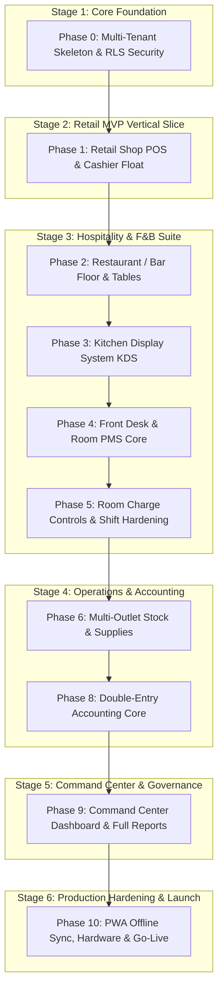

# Kore Bench — Master Roadmap: MVP to Production

> **Implementation note:** references to Supabase below are historical — the project now runs on plain PostgreSQL (Neon), with auth/session/RLS-context handled by Next.js API routes. See [DATABASE_SETUP.md](DATABASE_SETUP.md).

This roadmap defines the engineering milestones, implementation sequence, and exit criteria for building **Kore Bench** (Kenyan SME Hospitality & Retail Operations Platform) based on the authoritative [build-spec.md](build-spec.md).

---

## 🧭 High-Level Timeline & Milestones

---

## 📋 Detailed Phase Breakdown

---

### 🔹 Stage 1: Core Foundation & Multi-Tenant Architecture

#### Phase 0 — Foundation & Multi-Tenant Skeleton
- [ ] **Data & Tenancy Schema**:
  - PostgreSQL schema for `companies`, `properties`, `outlets`, `stations`, `users`, `roles`, `user_assignments`.
  - Row-Level Security (RLS) policies on every table scoped to `property_id` and `outlet_id`.
- [ ] **Authentication**:
  - Supabase Auth integration (Email/Password + Phone OTP support for Kenyan floor staff).
  - Secure session handling and role-based permissions.
- [ ] **Application Shell (Next.js 15+ PWA)**:
  - Responsive App Shell with sidebar navigation matching target reference structure.
  - Multi-property / Multi-outlet switcher for multi-site operators.
- [ ] **Vendor Back-Office**:
  - Directus instance configuration pointing to shared Postgres DB for vendor-only schema adjustments.

> **Exit Criteria**: A user from Property A cannot read/mutate Property B data via direct API/realtime queries. Disposable test property can be spun up and torn down cleanly.

---

### 🔹 Stage 2: Retail MVP Vertical Slice

#### Phase 1 — Retail Shop POS (Fast Checkout)
- [ ] **Property Settings (Catalog CRUD)**:
  - Categories, Items, Barcodes, Pricing, Stock-tracking flag.
- [ ] **Touch POS Screen**:
  - Fast search, category filters, cart management, quantity keypad, item notes.
- [ ] **Payment Capture**:
  - Multi-tender: Cash, M-Pesa (manual ref / Daraja STK push hook), Card, Split tender.
  - Thermal receipt formatting & WhatsApp/SMS shareable link generator.
- [ ] **Shift Float & Cashier Controls**:
  - Shift Open (opening float entry).
  - Shift Close (expected cash vs counted cash variance calculation).
  - Auto-decrement stock for tracked items.

> **Exit Criteria**: Cashier completes 3 sales with mixed tenders, closes shift with accurate immutable variance math. Idempotent payment submissions prevent duplicate orders.

---

### 🔹 Stage 3: Hospitality & F&B Suite

#### Phase 2 — Restaurant & Bar (Floor Plan & Tables)
- [ ] **Floor Configuration**:
  - Property Settings for Floor Areas (Dining, Terrace, Bar, VIP) and Table capacities.
- [ ] **Visual Table Management**:
  - Interactive table grid with real-time state (`Available`, `Occupied`, `Bill Requested`, `Payment Pending`, `Cleaning`).
- [ ] **Dine-In Order Workflow**:
  - Open table order, append items across multiple rounds without losing cart state, bill print.
  - Table transfer and check split/merge actions (policy-gated).

> **Exit Criteria**: Waiters can manage multiple tables concurrently, hold carts across refreshes, and settle table bills cleanly.

#### Phase 3 — Kitchen Display System (KDS & Delta KOTs)
- [ ] **Kitchen Order Ticket (KOT) Engine**:
  - Delta KOT generation: only newly added items are sent as tickets.
  - Prep station routing (`Kitchen`, `Bar`, `Grill`, `Pastry`).
- [ ] **KDS Interface**:
  - Touch-friendly ticket cards with elapsed time timers, aging indicators, course firing.
  - Strict server-side ticket state machine (`New` $\rightarrow$ `Accepted` $\rightarrow$ `Preparing` $\rightarrow$ `Ready` $\rightarrow$ `Served`).

> **Exit Criteria**: Adding items in multiple rounds sends correct delta tickets without duplications. Ticket state transitions cannot be bypassed.

#### Phase 4 — Front Desk & Rooms (PMS Core)
- [ ] **Room Setup & Inventory**:
  - Room types, room numbers, rate plans (Standard, Peak, Corporate).
- [ ] **Live Room Rack**:
  - Color-coded room grid (`Available`, `Occupied`, `Reserved`, `Dirty`, `Maintenance`, `Inspected`).
- [ ] **Bookings & Folios**:
  - Guest search/registration, reservations, check-in, check-out.
  - Itemized Guest Folio ledger auto-populated with room charges and service fees.
- [ ] **Housekeeping Workflow**:
  - Housekeeping status board; check-in strictly blocked on uninspected rooms.

> **Exit Criteria**: Receptionist can book, check in to an inspected room, post charges, settle folio, and check out end-to-end.

#### Phase 5 — Room Charge Controls & Shift Hardening
- [ ] **Two-Person Room Charge Custody Flow**:
  - Cashier requests charge to active guest stay from Restaurant/Bar POS.
  - Server validation (active stay, credit limit, non-zero balance).
  - Receptionist accepts/rejects charge in real-time before folio posting occurs.
- [ ] **Enhanced Cashier Shift Close**:
  - Blind count entry, reconciliation by tender, exception log, supervisor sign-off.
- [ ] **Approval Policies Engine**:
  - Tenant-configurable thresholds for discounts, voids, refunds, and room-charge overrides.

> **Exit Criteria**: Inter-outlet charges require reception verification. Reversals are linked documents, never destructive in-place edits.

---

### 🔹 Stage 4: Operations, HR & Accounting Engine

#### Phase 6 — Multi-Outlet Stock & Supplies
- [ ] **Inventory Control**:
  - Stock levels per outlet (Store, Bar, Kitchen).
  - Requisitions, stock transfers, purchase receiving against suppliers.
  - Wastage and breakage logging with mandatory reason codes.
- [ ] **Bill of Materials (BOM) / Recipes**:
  - Link menu items to raw ingredients for automatic ingredient deduction.

> **Exit Criteria**: Stock movements accurately reflect retail sales and kitchen consumption with negative stock warnings.

*(Phase 7 — HR & Kenya Payroll: Deferred for later build per project scope)*

#### Phase 8 — Accounting (Double-Entry Core)
- [ ] **Chart of Accounts**:
  - Pre-seeded Kenyan SME Chart of Accounts (Assets, Liabilities, Equity, Revenue, COGS, Expenses).
- [ ] **Automated Journal Engine**:
  - Automated balanced double-entry postings from POS sales, folio settlements, payroll runs, and COGS.
- [ ] **Expenses & Financial Reports**:
  - Operating expense capture with receipt attachments.
  - Real-time Trial Balance, Profit & Loss, Balance Sheet, and Cash Flow statement.

> **Exit Criteria**: Every operational transaction auto-posts balanced debits and credits. Manual entries are append-only and policy-gated.

---

### 🔹 Stage 5: Command Center & Management Analytics

#### Phase 9 — Command Center Dashboard & Full Reports
- [ ] **Unified Operations Command Center**:
  - Real-time KPI cards: Gross Revenue, Net Liquidity, Occupancy Rate, In-House Guests, Active Tables, KOTs in prep, Cashier variances.
  - Exception queues: Dirty room check-in attempts, aging KOTs, pending shift closes, pending room charges, low stock items.
- [ ] **Comprehensive Exportable Reports**:
  - Sales by outlet/cashier/tender, register X/Z reports, stock valuation, food cost analysis, tax summaries (KRA eTIMS ready).

> **Exit Criteria**: All dashboard KPI cards and exception queues drill directly into their underlying operational source documents.

---

### 🔹 Stage 6: Production Hardening, Offline & Launch

#### Phase 10 — PWA Offline Sync, Hardware & Go-Live
- [ ] **Offline-First Resilience**:
  - Service Worker + IndexedDB queueing for offline POS & KOT capture with idempotent background sync upon reconnection.
- [ ] **Hardware & Integration Support**:
  - Thermal ESC/POS receipt printer integration (network/Bluetooth/USB).
  - Daraja M-Pesa automated STK push & C2B webhook listener.
  - KRA eTIMS fiscal compliance integration hooks.
- [ ] **Production Infrastructure**:
  - Production Supabase cluster, CDN edge routing, automated daily backups, Directus vendor panel secured behind VPN/MFA.

> **Exit Criteria**: System continues ringing sales and firing KOTs through complete network disconnection and syncs cleanly with zero data loss upon reconnect.

---

## 🎯 Target MVP vs Full Production Scope

| Milestone | Target Scope Included | User Persona Ready |
|---|---|---|
| **Retail MVP (Phase 0-1)** | Core Auth, Catalog, Fast Touch POS, Cash/M-Pesa, Thermal Receipts, Shift Open/Close, Stock decrement. | Retail Shop Cashiers, Store Owners |
| **Hospitality MVP (Phase 2-5)** | Floor Tables, KDS Tickets, Room Rack, Bookings/Folios, Verified Room Charges, Multi-Outlet Shift Closing. | Restaurant Waiters, Chefs, Baristas, Hotel Receptionists |
| **Full Operations Suite (Phase 6-9)**| Multi-Store Inventory, Double-Entry GL, Command Center KPIs. | General Managers, Accountants, Directors |
| **Production Release (Phase 10)** | Offline Sync, ESC/POS Hardware Bridge, Daraja M-Pesa Live STK, eTIMS compliance. | Live SME Customers across Kenya |

---

*We will build strictly following this sequencing. Current build stage: **Phase 8 — Double-Entry Accounting Core**. HR/payroll remains deferred.*
